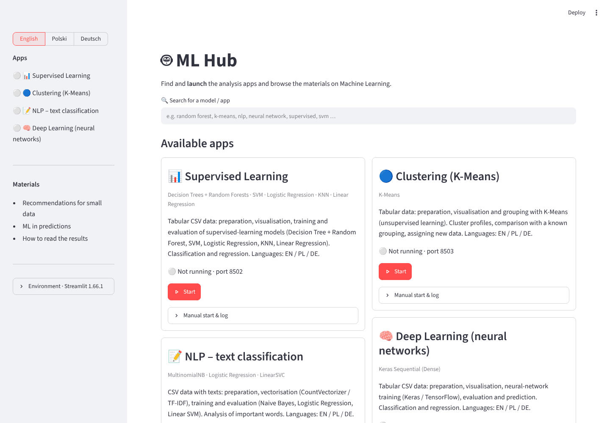
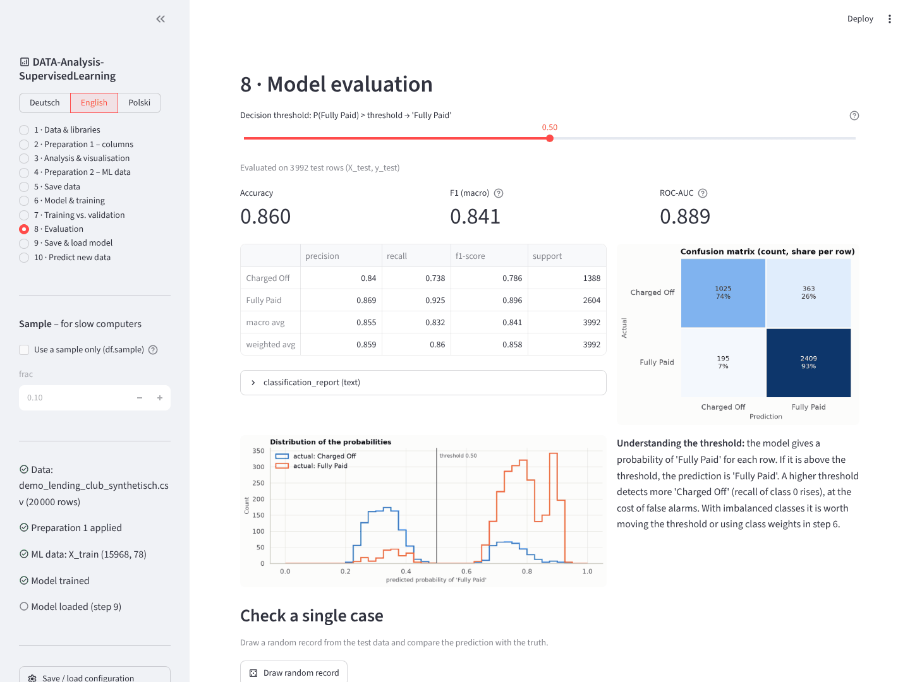

# 🤖 ML Hub – Machine Learning mit Python in vier Streamlit-Apps

[](https://github.com/danielkotok79-bit/Machine-Learning-HUB/actions/workflows/tests.yml)


**ML Hub** ist ein lokaler Launcher für vier Streamlit-Apps, die eine CSV-Datei durch den kompletten
Machine-Learning-Ablauf führen: Daten laden und bereinigen, untersuchen, ein Modell trainieren, bewerten, speichern
und auf neue Daten anwenden. Zu jedem Schritt zeigen die Apps den passenden Python-Code – sie eignen sich also auch
zum Lernen.

🌍 Launcher und alle Apps gibt es auf **Englisch** (Standard), **Polnisch** und **Deutsch**.  
📖 [README in English](README.md) · [README po polsku](README_PL.md)



## Die Apps

| App | Art des Lernens | Modelle | Beispieldaten |
|---|---|---|---|
| 📊 [**Überwachtes Lernen**](apps/Supervised) | überwacht – Klassifikation und Regression | Decision Tree + Random Forest, SVM, logistische Regression, KNN, lineare Regression | LendingClub |
| 🔵 [**Clustering**](apps/Clustering) | unüberwacht | K-Means (Ellbogen, Silhouette, Cluster-Profile, PCA-Karte) | College-Daten |
| 📝 [**NLP – Textklassifikation**](apps/NLP) | überwacht, Text | Bag of Words / TF-IDF + Naive Bayes, logistische Regression, lineare SVM | Yelp-Bewertungen, SMS-Spam |
| 🧠 [**Deep Learning**](apps/Deeplearning) | überwacht – Klassifikation und Regression | Keras Sequential (Dense) mit TensorFlow, EarlyStopping | LendingClub |

Alle vier Apps folgen denselben zehn Schritten:

1. **Daten laden** – CSV hochladen oder Dateipfad; Trennzeichen und Dezimalkomma werden automatisch erkannt
2. **Spalten aufbereiten** – eine Aktion je Spalte (behalten, entfernen, Zahl extrahieren, Datum → Jahr/Monat, Werte zuordnen …) und neue Spalten aus Formeln
3. **Untersuchen** – Countplot, Histogramm, Boxplot, Streudiagramm, Korrelations-Heatmap, Pairplot, Gruppenstatistik …
4. **ML-Daten** – Label und Merkmale; **zuerst** `train_test_split`, danach fehlende Werte, Dummies und Skalierung – nur auf den Trainingsdaten gelernt (kein Datenleck)
5. **Daten speichern** – die aufbereiteten Daten als CSV (international oder für Excel)
6. **Modell & Training** – Modellwahl mit „Warum?“ und „Am besten für“, die wichtigsten Parameter
7. **Training vs. Validierung** – Validierungskurve bzw. Loss-Kurven, Diagnose von Over- und Underfitting
8. **Bewertung** – classification_report, Konfusionsmatrix, ROC-AUC, Entscheidungsschwelle, Merkmalswichtigkeit · Regression: MAE, RMSE, R²
9. **Modell speichern & laden** – `.skops` (sicher) oder `.joblib` + `preprocessing.json`, ZIP-Download, die ganze Pipeline als Python-Skript
10. **Neue Daten vorhersagen** – dieselbe Aufbereitung wird automatisch angewendet, dann Vorhersage, Erklärung und Fazit

Clustering und NLP passen die Schritte 4–10 an ihre Aufgabe an (z. B. Wahl von K und Cluster-Profile bzw. die
wichtigsten Wörter je Klasse). Details stehen im README der jeweiligen App (DE · EN · PL).


*Überwachtes Lernen, Schritt 8: Bewertung eines Random Forest auf synthetischen, LendingClub-ähnlichen Daten (siehe [Ausprobieren ohne eigene Daten](#ausprobieren-ohne-eigene-daten)).*

## Schnellstart

Voraussetzung: **Python 3.10 oder neuer** (die Deep-Learning-App braucht wegen TensorFlow Python 3.10–3.13).

```bash
git clone https://github.com/danielkotok79-bit/Machine-Learning-HUB.git
cd Machine-Learning-HUB
python -m venv .venv
source .venv/bin/activate                         # Windows: .venv\Scripts\activate
pip install -r requirements.txt                   # Launcher + Supervised, Clustering, NLP
pip install -r apps/Deeplearning/requirements.txt # nur für die Deep-Learning-App (TensorFlow)
streamlit run app.py                              # öffnet http://localhost:8501
```

Im Launcher bei einer App auf **Starten** und danach auf **Öffnen** klicken. Die Apps laufen im Hintergrund auf den
Ports **8502–8505** (auch nach dem Schließen des Launchers) und starten in der Sprache des Launchers; **Stoppen**
beendet sie. PIDs und Logs liegen im Ordner `.mlhub/`. Fehlt ein Paket, zeigt der Launcher den passenden
`pip install`-Befehl.

Jede App lässt sich auch einzeln starten:

```bash
cd apps/Supervised
streamlit run app.py -- --lang de                 # oder en, pl · öffnet http://localhost:8501
```

> **Ältere Streamlit-Version (z. B. 1.51 aus Anaconda)?** Die Apps verwenden `st.segmented_control(required=…)`,
> das es erst ab Streamlit 1.56 gibt. Der Launcher startet die Apps über `mlhub_compat.py`, das diesen Parameter in
> älteren Versionen ergänzt – aus dem Launcher funktioniert also alles. Ohne Launcher im App-Ordner
> `python ../../mlhub_compat.py run app.py` statt `streamlit run app.py` verwenden oder Streamlit aktualisieren:
> `pip install --upgrade "streamlit>=1.56"`.

## Ausprobieren ohne eigene Daten

Die Datensätze aus dem Kurs sind nicht Teil des Repositorys. Jede App kann eine **synthetische** Datei mit denselben
Spalten und Formaten wie der Originaldatensatz erzeugen – so lässt sich alles sofort ausprobieren:

| App | Befehl (im App-Ordner) | Erzeugt |
|---|---|---|
| Supervised | `python tests/synthetic.py` | `demo_lending_club_synthetisch.csv` (20 000 Zeilen) |
| Clustering | `python tests/synthetic.py` | `demo_college_synthetisch.csv` (777 Zeilen) |
| NLP | `python tests/synthetic.py` · `python tests/synthetic.py --sms` | `demo_yelp_synthetisch.csv` (10 000 Bewertungen) · `demo_sms_synthetisch.txt` |
| Deep Learning | `python tests/synthetic.py` | `demo_lending_club_synthetisch.csv` (20 000 Zeilen) |

Die Datei in Schritt 1 laden. Für diese Datensätze bieten die Apps eine fertige Beispiel-Konfiguration (`configs/`)
an, die Aufbereitung und Modell wie in den Kursprojekten einstellt.

## Materialien

Neben den Apps enthält der Launcher kurze Lernmaterialien und drei Dokumente zum Herunterladen – jeweils auf
Englisch, Polnisch und Deutsch. Der Launcher bietet die Fassung in der gewählten Sprache an, die übrigen stehen unter
*Andere Sprachen*. Alle Dateien liegen in [`materials/`](materials):

| Dokument | Inhalt | EN | PL | DE |
|---|---|---|---|---|
| FAQ | kleine Datensätze und neuronale Netze – wann ein Netz sinnvoll ist, Einstellungen für Early Stopping | [PDF](materials/FAQ_EN.pdf) | [PDF](materials/FAQ_PL.pdf) | [PDF](materials/FAQ_DE.pdf) |
| ML in Prognosen | Machine Learning in Finanz-, Börsen- und Politikprognosen | [PDF](materials/ML_in_predictions_EN.pdf) | [PDF](materials/ML_in_predictions_PL.pdf) | [PDF](materials/ML_in_predictions_DE.pdf) |
| Ergebnisse interpretieren | Ergebnisse von 8 ML-Kurs-Notebooks richtig lesen (Daten, Training, Testergebnisse) | [PDF](materials/Reading_ML_results_EN.pdf) | [PDF (PL + DE)](materials/Reading_ML_results_PL-DE.pdf) | [PDF (PL + DE)](materials/Reading_ML_results_PL-DE.pdf) |

Die polnische und die deutsche Fassung des dritten Dokuments sind eine gemeinsame zweisprachige Datei (zuerst der
polnische, dann der deutsche Teil).

## Tests

**912 automatische Tests** (pytest, darunter Tests der gesamten Oberfläche mit Streamlit `AppTest`) – je App:

```bash
pip install pytest
cd apps/Supervised
pytest -q
```

| App | Tests |
|---|---|
| Supervised | 266 |
| Clustering | 268 |
| NLP | 188 |
| Deep Learning | 190 |

Jeder App-Ordner enthält außerdem eine `AUDIT.md` (auf Polnisch) mit den Ergebnissen der Code-Reviews: gefundene
Fehler, ihre Korrektur und die Regressionstests, die sie abdecken.

## Projektstruktur

```
.
├── app.py               Launcher (ML Hub)
├── mlhub_compat.py      Kompatibilitäts-Fix für Streamlit < 1.56
├── requirements.txt
├── materials/           PDF-Dokumente (EN · PL · DE) im Launcher
├── docs/screenshots/
└── apps/
    ├── Supervised/      📊 scikit-learn – fünf Modelle des überwachten Lernens
    ├── Clustering/      🔵 K-Means
    ├── NLP/             📝 Textklassifikation
    └── Deeplearning/    🧠 Keras / TensorFlow
```

Jede App ist gleich aufgebaut:

```
app.py              Streamlit-Oberfläche
pipeline.py         Rechenlogik – auch im Notebook nutzbar (import pipeline as pl)
plots.py            Diagramme (matplotlib / seaborn)
codegen.py          erzeugt den in der App angezeigten Python-Code
i18n.py, locales/   Sprachen – die Texte stehen im Code auf Deutsch, locales/ enthält Englisch und Polnisch
configs/            Beispiel-Konfigurationen
tests/              pytest-Tests + synthetische Testdaten
README.md           Deutsch · README_EN.md Englisch · README_PL.md Polnisch
AUDIT.md            Bericht der Code-Reviews (Polnisch)
```

Die Kommentare im Quellcode sind auf Deutsch, der Originalsprache des Codes.

## Technologien

Python · Streamlit · pandas · NumPy · scikit-learn · SciPy · skops · matplotlib · seaborn · TensorFlow / Keras · pytest
